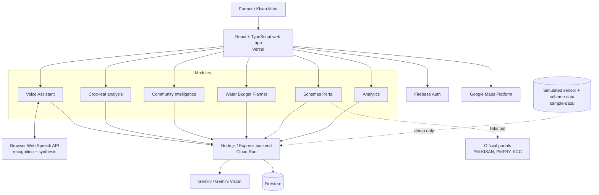

# Kisan Alert 360° — Technical Design

Live prototype: https://kisan-app-eight.vercel.app

## 1. Goals

1. Give small and marginal farmers timely, local-language guidance (Odia, Hindi, English), voice-first.
2. Combine risk insight, community alerts, scheme guidance and voice help in one app.
3. Keep the system modular so features can be added step by step.
4. Keep farmer data minimal and consent-based (DPDP Act 2023).

## 2. System architecture

Dashed lines mark demo-only data and links. In the prototype, sensor readings and scheme records are simulated. At deployment, scheme data is replaced with official sources, and applications are completed only on the official portals.

## 3. Components

| Component | Responsibility |
|---|---|
| React + TypeScript frontend | UI, language switching (Odia/Hindi/English), module navigation, charts |
| Voice layer | Speech input and spoken output through browser Web Speech APIs; falls back to text chat when unsupported |
| Node.js / Express backend | Holds secrets, calls Gemini, validates requests, reads and writes Firestore |
| Gemini / Gemini Vision | Answers farming questions in the selected language; analyses crop-leaf photos |
| Firebase Auth + Firestore | Sign-in and storage for user profile, community alerts and saved records |
| Google Maps Platform | Village/field location for alerts and water planning |

## 4. Key flows

### 4.1 Voice Assistant
1. Farmer speaks or types a question in the chosen language.
2. Frontend sends the message history and a language-specific system instruction to the backend.
3. Backend calls Gemini and returns the answer.
4. Answer is shown and read aloud (`or-IN`, `hi-IN` or `en-IN`) where the browser supports it.

### 4.2 Crop-leaf analysis
1. Farmer uploads a JPG/PNG/WebP leaf photo.
2. Gemini Vision first checks that the image is a single, clearly visible crop leaf.
3. If accepted, a second call suggests a likely issue with a confidence value.
4. Low confidence produces an "uncertain" result. High-risk advice is directed to verified guidelines and KVK officers rather than presented as final.

### 4.3 Community alert
1. A farmer reports a pest, disease or flood sign with location.
2. The alert is stored and shown to nearby farmers.
3. Planned: multiple-report verification and local moderation before an alert is promoted.

### 4.4 Scheme guidance
1. Farmer asks about a scheme or opens the Schemes Portal.
2. App explains eligibility and documents in the local language.
3. App links to the official portal. It never submits applications on the farmer's behalf.

## 5. Data model (Firestore, high level)

| Collection | Main fields |
|---|---|
| `users` | id, language, village/district, role (farmer / kisan_mitra), consent flags |
| `alerts` | id, type, description, location, reporterId, createdAt, confirmations |
| `diseaseRecords` | id, userId, crop, result, confidence, createdAt |
| `schemes` | id, name, summary (en/hi/or), officialUrl |
| `sensorReadings` | id, fieldId, moisture, temperature, timestamp (simulated in demo) |

## 6. Security and privacy

- API keys live in environment variables; `.env` is git-ignored and only `.env.example` is committed.
- `VITE_` variables are visible in the browser bundle, so restrict keys by HTTP referrer, set quotas, and call Gemini through the backend.
- Validate file type and size (8 MB limit) and request bodies on the server.
- Treat AI output as untrusted: parse against an expected schema before rendering.
- Collect minimal data with consent, in line with the DPDP Act 2023.
- Firestore security rules restrict reads and writes to the signed-in owner, except community alerts, which are readable by nearby users.

## 7. Risks and mitigations

| Risk | Level | Mitigation |
|---|---|---|
| Farmers without smartphones | High | Kisan Mitra agents, shared access points, SMS/voice alerts (planned) |
| Poor connectivity | High | Offline-first mode (planned) |
| AI gives a wrong suggestion | High | Show confidence; send high-risk advice to verified guidelines and KVK officers |
| False community alerts | Medium | Multiple-report verification and local moderation (planned) |
| Scheme data accuracy | Medium | Link to official portals; replace sample data with official sources at deployment |
| Data privacy | Medium | Minimal data, consent-based, DPDP Act 2023 aligned |

## 8. Deployment

- Frontend: Vercel (https://kisan-app-eight.vercel.app). Set the `VITE_*` variables in the project settings and redeploy after changes.
- Backend: Cloud Run (container built from the Express service).
- Data and auth: Firebase project.

## 9. Roadmap

Kisan Mitra agent mode · offline-first mode · SMS/IVR alerts · alert verification and moderation · field pilot (2 villages, about 50 farmers, one Kharif season) with FPO / SHG / KVK partners · accuracy testing with agriculture experts.
